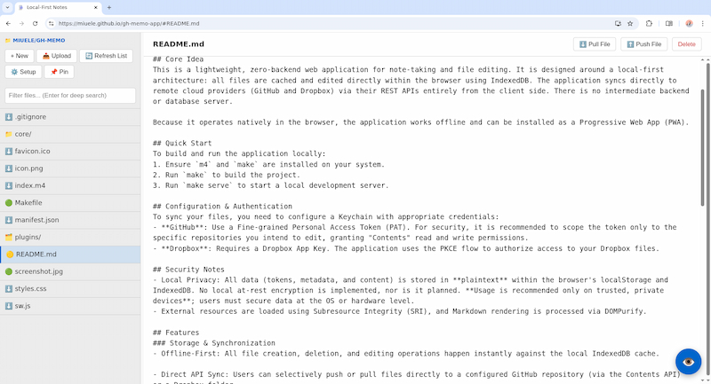

# gh-memo

[Try Online](https://miuele.github.io/gh-memo-app)



## Getting Started
"New" button creates a new file, and the preview button at the bottom-right toggles view mode (renders Markdown for a .md file).

Optionally, get your GitHub Personal Access Token (PAT), paste it in the settings and fill in the repository name. Dropbox and any remoteStorage server work too (see [Configuration & Authentication](#configuration--authentication)). Clicking "Refresh List" fetches file contents from the remote repository, "Pull" button pulls a file content, and "Push" button pushes the changes you made to a file.

## Core Idea
This is a single-page, zero-backend web application for note-taking and file editing. It is designed around a local-first architecture: all files are cached and edited directly within the browser using IndexedDB. The application syncs directly to remote providers (GitHub, Dropbox, and any [remoteStorage](https://remotestorage.io/) server, including the small one in `examples/` for a folder on your own computer) via their HTTP APIs entirely from the client side. There is no intermediate backend or database server.

Because it operates natively in the browser, the application works offline and can be installed as a Progressive Web App (PWA).

## Building and Running locally
Requires `m4` and `make`.
1. Run `make` to build the project. `index.html` is generated in `dist/`.
2. Run `make serve` to start a local development server.

Each build is stamped with its UTC time and, when built from a git checkout, the commit's short hash. The stamp is shown at the bottom of Settings and in the workspace name's tooltip, so you can tell which build you are running. Every build also gets its own offline cache: an installed app notices a new build and offers "New version available — Reload" in the status bar.

`dist/index.html` is self-contained and also runs when opened directly from disk (`file://`), except for offline caching and Dropbox linking, which need it to be served over http(s).

Optional, with Node.js installed (no packages needed):
- `make test` runs the unit tests in `tests/` with Node's built-in test runner.
- `make check` syntax-checks every module.

`tests/e2e/smoke.cjs` is an end-to-end smoke test of the built app with GitHub, Dropbox and a remoteStorage server mocked. It needs Playwright and is not part of the build; see the header of the file.

## Project Layout
The source is split into small modules under `src/`. Each file registers one module with a tiny loader (`src/define.js`), naming its dependencies explicitly:

```js
define('ui/pins', ['ui/refs', 'lib/dom', 'model/forest'], (DOM, Dom, Forest) => { /* ... */ return api; });
```

Outside `src/`: `tests/` (unit tests, plus the Playwright smoke test in `tests/e2e/`) and `examples/` (`rs_server.py`, a remoteStorage server for a local folder, and `panel_agent.py`, a sample program for the panel plugin in `src/plugins/panel/`).

`make` copies every module verbatim into `index.html` as its own inline `<script>`, and `app/boot` starts the app. Only `resources.m4` (the CDN URLs and SRI hashes, shared with the service worker) and `buildInfo.js.m4` (the build stamp) go through m4 macro expansion.

Each layer depends only on the layers above it:

| Directory | Contents |
|---|---|
| `lib/` | Helpers with no app state: paths, file types, encoding, network timeouts, DOM builder, PKCE, the cross-tab channel |
| `model/` | `config` (the only `localStorage` user), `forest` (workspace trees and path mapping), `symlink` |
| `storage/`, `remote/` | The IndexedDB cache, the GitHub, Dropbox and remoteStorage providers, Dropbox OAuth, the provider facade |
| `plugins/` | One file per file type, plus `registry` (see `src/plugins/README.md`) |
| `ui/` | Views. They render and report user input through callbacks, and never call actions directly |
| `actions/` | What the user can do: files, sync (and conflict markers in `merge`), pins, workspaces, keychains, settings; `host`, through which a plugin reads other stored files |
| `app/` | `boot` (wires views to actions and maps `data-action` attributes), routing, shortcuts, paste, cross-tab handling, service worker updates |

## Configuration & Authentication
To sync your files, you need to configure a Keychain with appropriate credentials:
- **GitHub**: Use a Fine-grained Personal Access Token (PAT). For security, it is recommended to scope the token only to the specific repositories you intend to edit, granting "Contents" read and write permissions.
- **Dropbox**: Requires a Dropbox App Key. The application uses the PKCE flow to authorize access to your Dropbox files.
- **remoteStorage**: Choose "remoteStorage" as the keychain's provider and paste a bearer token from the server. In the tree, put the server's storage URL (for example `https://192.168.1.10:8765/storage/`) in the Host field. "+ New Origin Tree" in Settings also accepts a storage URL directly. Sign-in through OAuth/WebFinger is not supported yet, so the server must be able to hand you a token.

### A folder on your computer (examples/rs_server.py)
`examples/rs_server.py` is a minimal remoteStorage server that serves one directory. It needs Python 3.9+ and, for HTTPS on a local network, the `openssl` command. Files stay plain files, so an editor, git or `examples/panel_agent.py` can work on the same folder.

1. Make a token for each device: `python3 examples/rs_server.py --add-token phone`. It prints the token once; paste it into that device's keychain.
2. Start the server. By default a page from any origin may call it, but every request still needs a token. To allow only your copy of the app, add `--allow-origin https://miuele.github.io` (or for example `http://localhost:8000` for `make serve`; repeat it to allow several). The server logs why it refuses a request.
   - Same computer only: `python3 examples/rs_server.py ~/notes`, then use `http://127.0.0.1:8765/storage/`. Browsers allow an https page to call `127.0.0.1` over plain HTTP.
   - Local network: `python3 examples/rs_server.py ~/notes --bind 192.168.1.10` (or `--bind 0.0.0.0 --ip 192.168.1.10`). The server then uses HTTPS with its own private certificate authority, which `openssl` creates once in `~/.config/gh-memo-server/`. That CA is limited by name constraints to the server's IP addresses, so even if its key leaked it could not vouch for any other site. The leaf certificate is valid for a year and is renewed at startup.
   - With a certificate you already have (for example from `tailscale cert`, or Let's Encrypt for your own domain): add `--cert` and `--key`, and `--host-name` with that name.
3. On each device, trust the CA once by importing the `ca.crt` path that the server prints:
   - **Windows / macOS / Linux, Chrome**: Settings > Privacy and security > Security > Manage certificates, and import it as a trusted authority (on Windows and macOS this is the system store).
   - **Firefox (desktop)**: Settings > Privacy & Security > Certificates > View Certificates > Authorities > Import, and tick "Trust this CA to identify websites".
   - **Android**: Settings > Security > Encryption & credentials > Install a certificate > CA certificate. Chrome uses it then. Firefox for Android also needs its hidden switch: Settings > About Firefox, tap the logo five times, then Settings > Secret Settings > "Use third party CA certificates".
4. In Chrome, the first request to a local address shows a "Local network access" prompt; allow it.

`--insecure-http` allows plain HTTP on a LAN address, but Firefox blocks an https page from calling it, and Chrome only allows it after the local network prompt.

Every write names the version it replaces (`If-Match`), so a push over a newer remote version is refused and you are asked to pull first, also when the newer version came from another program editing the folder. One race is not caught: a program that writes the same file during the instant between the server's check and its write is overwritten.

## Security Notes
- Local Privacy: All data (tokens, metadata, and content) is stored in **plaintext** within the browser's localStorage and IndexedDB. No local at-rest encryption is implemented, nor is it planned. **Usage is recommended only on trusted, private devices**; users must secure data at the OS or hardware level.
- External resources are loaded using Subresource Integrity (SRI), and Markdown rendering is processed via DOMPurify.

## Features
### Storage & Synchronization
- Offline-First: All file creation, deletion, and editing operations happen instantly against the local IndexedDB cache.

- Direct API Sync: Users can selectively push or pull files directly to a configured GitHub repository (via the Contents API), a Dropbox folder, or a remoteStorage server.

- Conflict Resolution: If a file is modified locally and remotely, the application intercepts the pull request and provides a basic text diff merge to prevent data loss.

- Cross-Tab Locking: Utilizes the browser's BroadcastChannel API to detect if a file is being edited in another tab, freezing the UI to prevent local overwrite conflicts.

### Virtual File System (VFS)
- Decoupled Credentials: Authentication tokens (Keychains) are managed separately from repository configurations (Workspaces). A single GitHub token can be mapped to multiple workspace mount points.

- Chroot Mount Points: Workspaces can be configured to mount specific sub-directories of a repository (e.g., src/docs), abstracting the rest of the repository away.

- Workspace Forest: Workspaces sharing a remote origin are grouped into trees. This enables tree-level navigation and pin resolution across multiple mount points.

- Declarative Symlinks: Supports .symlink files containing JSON payloads. Clicking these files triggers the application router to instantly tear down the current environment and load a different locally configured workspace. Example: `{ "owner": "rust-lang", "repo": "nomicon", "rootDir": "src" }`

### Editing & Organization
- Format Support: Includes a plugin architecture for rendering different file types. It supports raw text editing, rich Markdown rendering (including KaTeX math parsing and syntax highlighting), and read-only viewing for PDFs and images. A plugin edits only the open file and never uses the network; other files (such as a note's local images) it reads from the local cache of the same repository; see `src/plugins/README.md`. An image stored after its note is open appears without reopening the note.

- Pinning: Files and directories can be pinned for quick access. Pins are stored at the repository (tree) level.

- Deep Search: Includes a client-side search function that scans both filenames and the raw text content of all files currently cached in the active workspace.

## Technical Limitations
As a client-side application, behavior is bound by provider and browser constraints:

- API Limits: GitHub's Contents API limits file transfers to 10MB. remoteStorage servers set their own limit (`examples/rs_server.py` accepts up to 100MB).
- Memory: Large binaries are held in memory during use; performance may degrade on low-end devices.
- Git Bloat: Git handles binaries poorly; frequent updates to large files will cause repository bloat.
- Rate Limiting: High-frequency recursive fetching may trigger secondary rate limits.

## Notes
- AI assistants were used extensively for coding. Nevertheless the application models and architectural decisions are my own.
- App icon "Bloc Notes SZ" by [Fmaunier](https://commons.wikimedia.org/wiki/File:Bloc_Notes_SZ.png), licensed under [CC BY-SA 3.0](https://creativecommons.org/licenses/by-sa/3.0/).
